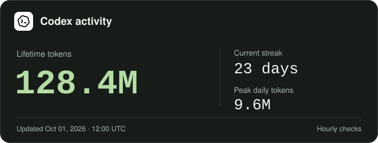
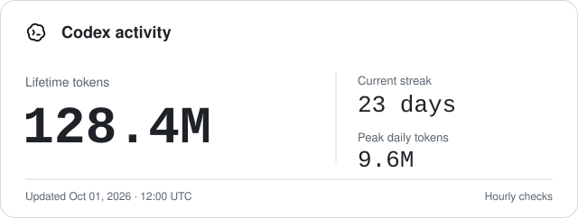
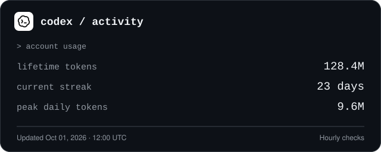
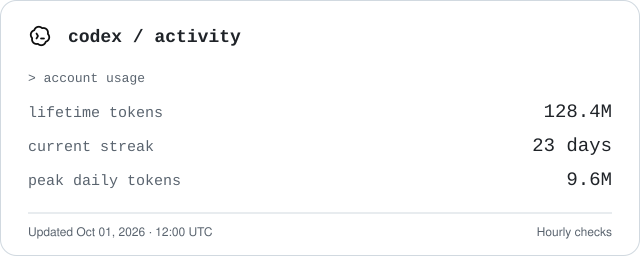
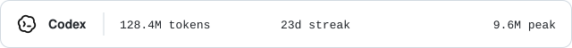

# Codex Activity Card

Generate a self-contained Codex usage SVG for a GitHub profile README. Choose a Minimal, Terminal, or Badge layout in light or dark colors. One local Codex account summary supplies all variants; no hosted service or runtime dependencies are required.

<p>
  
</p>

The checked-in previews use fixed illustrative values, not a live account.

## Layouts and themes

| Layout | Dark | Light |
| --- | --- | --- |
| Minimal |  |  |
| Terminal |  |  |
| Badge |  |  |

Minimal is the default. Layout and theme are independent, so `--template terminal --theme light` works too. The Codex mark is embedded in each SVG; `--no-logo` provides a text-only version. See the [mark's source and attribution](./assets/brands/README.md).

## Requirements

- Node.js 18 or later.
- A locally installed, signed-in Codex CLI whose app-server exposes aggregate usage.
- Git and a scheduler only if you want automatic publication.

## Use it in your profile

Keep this repository on the signed-in machine and render directly into your separate GitHub profile checkout:

```bash
npm run update -- --output /absolute/path/to/profile/assets/codex-activity.svg
```

The destination directory is created if needed; an existing template file is not required. The defaults are `--template minimal --theme dark --cadence hourly`.

Add the result to your profile README, then commit and push it:

```html

```

Select a different layout and theme:

```bash
npm run update -- --output /absolute/path/to/profile/assets/codex-activity.svg --template terminal --theme light
```

Generate all six variants from the same usage request:

```bash
npm run update -- --output /absolute/path/to/profile/assets/codex-activity.svg --variants-dir /absolute/path/to/profile/assets/codex
```

The variants are named `codex-minimal-dark.svg`, `codex-minimal-light.svg`, `codex-terminal-dark.svg`, `codex-terminal-light.svg`, `codex-badge-dark.svg`, and `codex-badge-light.svg`.

For a profile that follows GitHub's selected color scheme, reference the matching generated files:

```html
<picture>
  <source media="(prefers-color-scheme: dark)" srcset="./assets/codex/codex-minimal-dark.svg" />
  
</picture>
```

## Hourly checks

Run the updater hourly and publish only changed files. For example, cron can call your publication wrapper at minute 17 of each hour:

```cron
17 * * * * /absolute/path/to/refresh-profile.sh >> /absolute/path/to/refresh-profile.log 2>&1
```

Use an explicit executable path or set `PATH` in the wrapper so cron can find Node and Codex. The wrapper should prevent overlapping runs with `flock`, stop on errors, stage only the generated SVGs, and commit/push only when `git diff --cached --quiet` reports a change. Keep Git credentials and the wrapper outside this repository.

`--cadence hourly`, `--cadence daily`, and `--cadence manual` change the card's check-frequency label; they do not install a scheduler. Use the value that matches your actual schedule.

The card's `Updated` timestamp records its last content change after a successful account check. It is neither the service's data timestamp nor the time of the latest poll. An unchanged summary keeps the existing SVG stable, even across days, so an hourly check does not create a timestamp-only commit. Invalid or unavailable usage leaves the last good card intact.

For local scheduler health, add `--status /absolute/path/outside-your-repo/status.json`. This optional file records the latest check time, success or a generic error, and the number of changed files. It contains no account usage or authentication data; keep it outside the public profile repository.

## Offline rendering and development

Render your own aggregate-only JSON without starting Codex:

```json
{
  "lifetimeTokens": 128432187,
  "currentStreakDays": 23,
  "peakDailyTokens": 9612340
}
```

```bash
npm run update -- --input /absolute/path/to/aggregate.json --output /absolute/path/to/card.svg
```

Each value must be a non-negative safe integer. Missing or malformed counts are rejected before publication.

Regenerate the reproducible example gallery and run the checks:

```bash
npm run examples
npm test
npm run check
node scripts/render-examples.mjs --check
```

The example generator never reads account data or needs a Codex sign-in.

## Data and privacy

The card shows lifetime tokens, current streak in days, and peak daily tokens from the account summary. These are usage measures, not estimates of productivity or code shipped. Exact counts are included in the SVG's accessible description.

The updater requests aggregate usage through the local Codex app-server; it does not read authentication files or collect conversations, source code, project paths, or message bodies. No API keys or environment variables are needed by this tool. Keep scheduler credentials outside the repository.

Daily history, charts, ChatGPT usage, and other providers are not collected. The current source does not supply a daily time series, and a provider logo alone does not add a provider's usage data.

## License

Code is [MIT licensed](./LICENSE). Product names and marks belong to their respective owners; see [brand attribution](./assets/brands/README.md).
